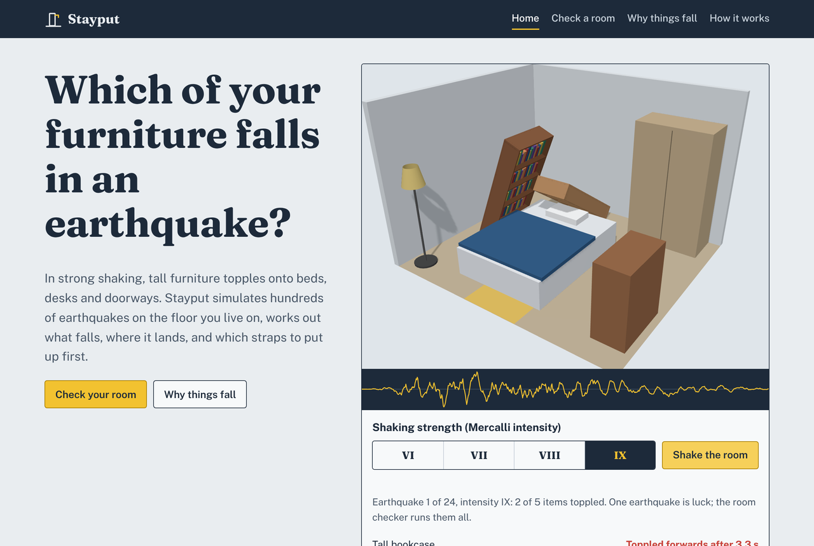
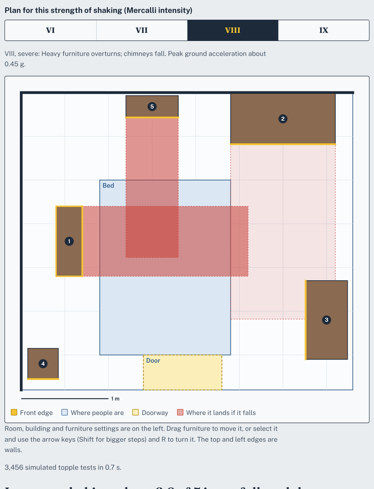
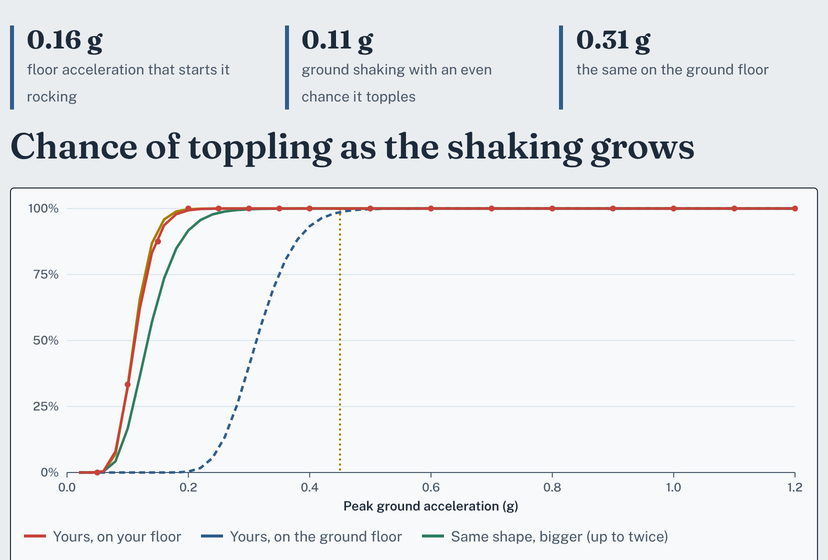
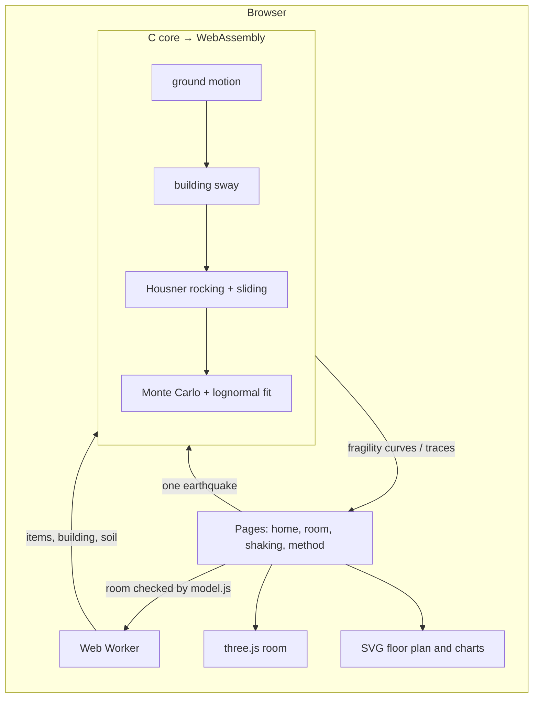

# Stayput

**Which of your furniture falls in an earthquake, where it lands, and what to anchor first.**

[](https://github.com/reihooneh/stayput/actions/workflows/ci.yml)
[](https://reihooneh.github.io/stayput/)
[](LICENSE)


**Live:** https://reihooneh.github.io/stayput/

Stayput simulates hundreds of earthquakes on the floor you live on, rocks every piece of furniture in your room on its edges, and tells you the chance each one topples, whether it lands on the bed, the cot, the desk or across the door, and the order to strap things to the wall in. It runs entirely in your browser: a C simulation core compiled to WebAssembly, a 3D room you can shake, and a floor plan you can drag furniture around on.



## Why I built this

Falling and moving furniture is one of the commonest causes of injury indoors in an earthquake. The Tokyo Fire Department puts it at about 30–50% of injuries in recent large earthquakes in Japan. Every preparedness guide says "secure tall furniture", but none tells you *which* piece in *your* room is most dangerous, or how much higher the risk is on the 8th floor of an apartment block than in a house.

The physics to answer that has existed since Housner's 1963 paper on rocking blocks, and earthquake engineers use fragility curves for buildings every day. Stayput puts the two together for a bedroom. The only tools I could find were a commercial VR plugin that replays one earthquake, and research papers; nothing gives a household a probability and a plan.

## Features

- **Realistic shaking, made to order:** synthetic two-component earthquakes (Kanai–Tajimi and Clough–Penzien filtered noise with an envelope) for rock, firm or soft ground, at 16 strengths from 0.05 g to 1.2 g.
- **Your floor, not the ground:** the building's first mode, a 5%-damped oscillator with a period of 0.1 s per storey that yields at 0.35 g, turns ground shaking into the motion on your floor. A 1.9 m bookcase that needs about 0.31 g of ground shaking to have an even chance of toppling in a house needs only about 0.14 g on the 8th floor of a 10-storey block.
- **Housner rocking for each piece of furniture:**
  - it starts rocking only above *g* tan α, loses spin at each impact, and topples past α;
  - a wall behind stops it falling backwards;
  - furniture whose feet grip less than tan α slides instead (Coulomb friction).
- **Fragility curves:** the share of earthquakes that topple each item at each strength, fitted by maximum likelihood with a lognormal curve.
- **Where it lands:** a toppled item lies in a strip as long as it is tall. Stayput checks it against the bed, the cot, the desk, the sofa and the doorway, and ranks items by expected harm.
- **A plan:**
  - what to anchor first, with two straps for heavy pieces;
  - when moving heavy things to the bottom shelves is enough;
  - how the risk to the bed drops after each step;
  - a downloadable checklist.
- **Four pages:**
  - **Home:** shake a 3D bedroom with a live seismograph.
  - **Check a room:** edit a room and get the plan.
  - **Why things fall:** live fragility curves showing the size and floor effects.
  - **How it works:** the method, checks against theory, and a live size-effect test.





## How it fits together



## Stack

- **Core:** C17, compiled with clang to `wasm32` with no C library (it brings its own sine, exponential, logarithm, normal distribution and PCG32 generator). It is 13 KB of WebAssembly with fixed memory.
- **Front end:** plain JavaScript modules, three.js 0.186 (self-hosted), and hand-drawn SVG. There is no framework and no runtime dependency beyond three.js.
- **Tests:**
  - the native C build under AddressSanitizer and UBSan;
  - `node:test` for the room model and the WebAssembly interface;
  - Playwright 1.63 for every page at three screen sizes.
- **Hosting:** GitHub Pages, deployed by GitHub Actions.

## Run it

```bash
npm ci                 # pinned dev packages: three, fonts, playwright
npm run build          # clang → site/assets/stayput.wasm, then the pages
npm run serve          # http://127.0.0.1:4173/
```

You need clang with the `wasm32` target and `lld` (on Ubuntu: `apt install clang lld`).

## Tests

```bash
npm run test:core      # 75 checks in C, under AddressSanitizer and UBSan
npm test               # room model, hostile files, WebAssembly interface
npm run test:web       # every page at phone, tablet and desktop sizes, plus features
make lint              # strict warnings and clang-tidy
```

What they check:

- **Physics against theory:**
  - rocking starts exactly at *g* tan α;
  - Housner's restitution and frequency;
  - sliding distance by hand (within 2%);
  - resonance of the top floor against the oscillator's formula (within 6%);
  - the fit recovering a known curve (within 1%);
  - the size effect;
  - a wall stopping backward falls.
- **Maths:** the core's own maths against the C library, to 10⁻¹².
- **Robustness:** random and invalid inputs under the sanitizers.
- **Hostile files:**
  - `__proto__`, `constructor`, HTML in names;
  - oversized files, out-of-range numbers;
  - items outside the room.
- **Browser behaviour:**
  - no text, shapes or controls overlapping, and no sideways scrolling, at three sizes;
  - a strict CSP;
  - the page working without WebGL.

## Security

- **Untrusted room files:** files are size-limited, strictly checked field by field, refused on any unknown key, and never echoed in errors.
- **No HTML from strings:** the page builds no HTML from text, and a test fails the build if it ever does.
- **Strict Content-Security-Policy:** no inline code, and nothing loaded from other sites.
- **Fixed memory:** the WebAssembly core has fixed memory and re-checks every argument.
- **No server:** nothing you enter leaves your browser.

See [SECURITY.md](SECURITY.md) for the threat model and how to report a problem.

## Limits

Stayput is a planning aid, not an engineering assessment.

- **The furniture model:** each item is a rigid block rocking along its depth. It ignores contents falling out, drawers, legs and castors, and items hitting each other.
- **The earthquakes and building:** the earthquakes are synthetic, and the building is a single yielding oscillator.
- **Anchors:** it assumes an anchor screwed into a stud or solid wall holds.

## Roadmap

- Rocking in both directions at once (3D rocking), for squat items that can tip sideways.
- Real recorded earthquakes as an option, scaled to a local hazard level.
- Contents: shelves that shed their books and drawers that slide open.
- A printable one-page plan with anchor positions drawn on the wall.

See [HOW-IT-WORKS.md](HOW-IT-WORKS.md) for the design, the physics, trade-offs and interview questions.
